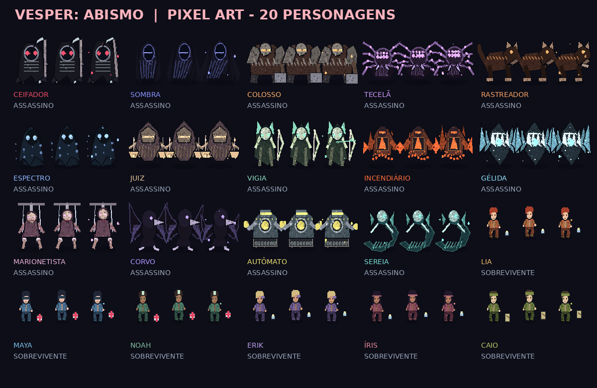
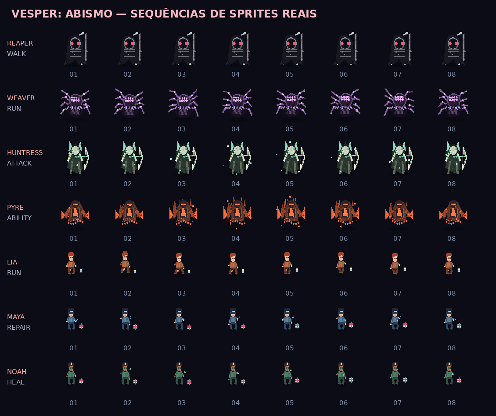
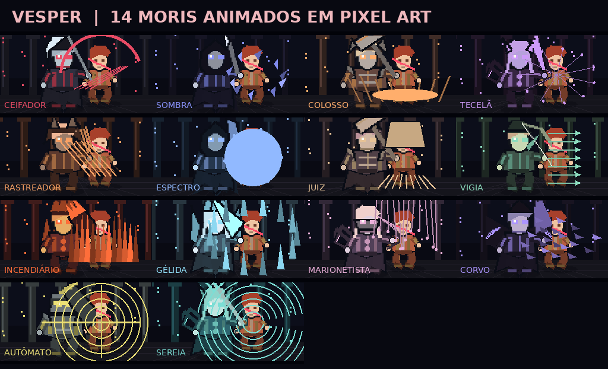

# 🩸 VESPER: ABISMO · Rework 3.0 / Pixel Art Edition



**Terror assimétrico em pixel art, para um jogador controlar o assassino contra seis sobreviventes com inteligência artificial.** Projeto criado com HTML5/Canvas, JavaScript e Java para Android, com todos os recursos do jogo empacotados localmente no APK.

[](https://github.com/V-prof1/Vesper/actions/workflows/android-apk.yml)

## 🎮 O jogo

- **14 assassinos** com 42 habilidades distintas (3 por killer), efeitos em campo e tempos de recarga específicos — investida apenas para especialistas em velocidade.
- **6 sobreviventes controlados por IA**, capazes de reparar, se curar, resgatar companheiros e executar loops.
- **10 mapas** com zonas de cobertura, paletes, janelas e rotas de loop variadas, sorteados ou selecionados antes da partida.
- Geradores com testes de perícia, paletes, ganchos, portões, ferimentos e finalizações.
- Loja de perks, níveis, experiência e builds, com salvamento local.
- **4.920 quadros de sprites**, distribuídos entre 20 personagens e 14 moris personalizados.
- Controles para celular e PC, modo paisagem no APK.

### 🕹️ Jogar no PC

Baixe o repositório e abra `index.html` ou `JOGAR_NO_PC.html` **mantendo a pasta `assets/` ao lado**. Use WASD para se movimentar; Espaço ou clique para atacar; Q/E/R para habilidades; F para interagir; **G para soltar o sobrevivente carregado**; X para executar; Esc/P para pausar. No celular, use o analógico e os botões na tela; **SOLTAR** aparece durante o carregamento.

A versão de navegador é mantida para pré-visualizar e desenvolver o jogo. **O port Android roda offline**: o HTML e os sprites ficam dentro do próprio APK.

## 📱 Como gerar o APK no GitHub

1. Abra a aba **[Actions](https://github.com/V-prof1/Vesper/actions/workflows/android-apk.yml)**.
2. Selecione **VESPER • Android APK** → **Run workflow** → **Run workflow**.
3. Abra a execução concluída e baixe o artefato **`VESPER-ABISMO-PIXEL-APK`**.
4. Extraia o arquivo ZIP do artefato e instale `app-debug.apk` no Android (pode ser necessário permitir instalação desta origem).

O workflow também compila automaticamente quando há mudanças relevantes na branch `main`. **O APK é uma build de teste (debug)**, não assinada para lançamento na Play Store. A compilação e o funcionamento no dispositivo precisam ser confirmados no próprio GitHub/Android.

## ⚔️ Rework 3.0 — Poderes / furtividade / mapas

- **Q / E / R**: cada assassino possui três poderes exclusivos. O **Ceifador** usa foice, sino e runas; a **Tecelã** usa salto aracnídeo, visão de teias e casulo; a **Vigia** é focada em flechas; o **Autômato** tem EMP, radar e sentinela; a **Sombra** e o **Espectro** possuem invisibilidade real para a percepção dos bots.
- **Investidas e mobilidade veloz** ficam com assassinos especializados, enquanto os demais usam áreas de perigo, projéteis, informação, armadilhas ou teleporte.
- **Botão SOLTAR**: pressionar **G** ou o botão **⇣** no celular devolve o sobrevivente carregado ao estado caído, permitindo evitar salvamentos por lanterna ou palete.
- **Mapas**: Ferro-Velho, Catedral, Pântano, Estação, Laboratório de Vidro, Mansão das Máscaras, Bosque dos Sussurros, Túneis do Subsolo, Docas do Fim e Observatório Partido.
- **Balanceamento inicial**: os seis novos mapas têm 6 pontos de surgimento, 8 geradores, 9 paletes, 5 janelas e 10 ganchos cada. Todos os pontos de objetivo possuem caminho acessível a partir dos pontos de surgimento nas verificações de navegação.
- **IA sem informação mágica**: a furtividade elimina a visão/audição direta e limpa as últimas posições conhecidas dos sobreviventes; os bots voltam a detectar o killer somente depois que ele sai do estado invisível. Algumas ações de suporte também deixam de considerar automaticamente a posição oculta.

> A acessibilidade dos mapas e o funcionamento das habilidades foram testados em simulação. O equilíbrio competitivo completo ainda depende de partidas jogadas por pessoas e testes reais no Android.

## 🎨 Sprites e moris

| Ativo | Quantidade | Detalhes |
| --- | ---: | --- |
| Assassinos | 14 | 160 quadros por personagem: parado, andar, correr, atacar, habilidade, dano e carregar. |
| Sobreviventes | 6 | 204 quadros por personagem: movimento, dano, reparar, cair, gancho, saltar, carregar, curar. |
| Moris | 14 | 104 quadros exclusivos por assassino, pixel art 256×144. |
| **Total** | **4.920** | Atlas PNG transparentes, manifest `sprites.json`, animação nearest-neighbor. |





## 📁 Estrutura

```text
index.html                            # jogo na raiz, preview local / GitHub Pages se habilitado
assets/characters/                   # 20 spritesheets para a versão HTML
assets/moris/                        # 14 spritesheets de finalização
assets/sprites.json                  # índices e fps
app/src/main/assets/index.html        # cópia empacotada no APK
app/src/main/assets/assets/           # spritesheets offline dentro do APK
app/src/main/java/.../MainActivity.java
app/src/main/AndroidManifest.xml
.github/workflows/android-apk.yml     # CI para gerar o APK de debug
tools/build_sprites.py               # gerador dos sprites (Pillow)
tools/integrate_game.py              # integra sprites ao jogo
tools/vesper_base.html               # versão-base anterior à pixel art
tools/killer_rework_v3.js            # lógica e visuais de 42 habilidades + seis novos mapas
tools/apply_rework_v3.py             # integrador do rework 3.0
```

## 🛠️ Desenvolvimento

Para regenerar os sprites: instale **Python 3** e **Pillow** (`python -m pip install pillow`) e execute `python tools/build_sprites.py`; o script cria os PNG em `app/src/main/assets/assets/`. Para manter as cópias web e Android sincronizadas após editar assets, copie os atlas para `assets/` e ajuste o jogo se necessário.

Para validar os arquivos localmente, execute `python tools/validate_assets.py` na raiz do repositório. O jogo é offline, sem backend e sem login.

## ⚠️ Limitações

Pixel art gerada proceduralmente (não são desenhos manuais); moris 2D estilizados. O port usa Android WebView e `targetSdk 28` na base atual, **não preparado para publicação na Google Play**. Antes de distribuir, atualizar SDK alvo, testar desempenho, controles e compatibilidade e configurar assinatura release.

**Créditos:** desenvolvimento colaborativo e prototipagem com assistência de IA. Licença do repositório em [`LICENSE`](LICENSE).
